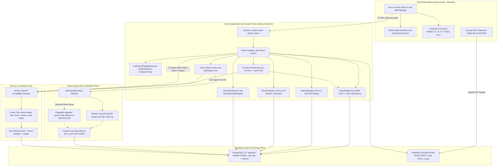

# 01: End-to-End System Architecture

**Product:** `KejarSNBT` (Personal UTBK-SNBT Remediation & 800+ Mastery Instrument)
**Phase:** Phase A (System Architecture & Security Boundaries)
**Scope:** Personal single-user power tool first, built with clean relational `user_id` ownership boundaries for effortless future multi-user expansion.
**Deployment Target:** Local-first development -> 100% Vercel-native production deployment (Next.js App Router) backed by Supabase Free Tier (PostgreSQL 16+ with `pgvector` + Supabase Storage) and `9router`.

---

## 1. System Vision & Architectural Philosophy

`KejarSNBT` is engineered for a single high-stakes cognitive transition: taking a student with severe foundational deficits ("fondasi hancur" in arithmetic, fractions, algebraic manipulation, and logical parsing) to top 0.5% UTBK-SNBT readiness (800+ IRT composite score) across all seven official subtests (`PU`, `PPU`, `PBM`, `PK`, `LBI`, `LBE`, `PM`).

To uphold **Lean Scope, Extreme Depth, Zero AI Slop** (`BLUEPRINTS.md`) and clean engineering discipline (`GEMINI.md`), the system rejects distributed microservices sprawl in favor of a **strictly layered Modular Monolith** deployed on Vercel:

1. **Zero Business Logic in UI or Route Handlers:** Pure pedagogical engines (`MasteryEngine`, `FsrsScheduler`, `DualTrackPedagogyService`, `TelemetryAndIrtEngine`) live in isolated TypeScript domain modules (`src/domain/*`) with deterministic unit-testable inputs and outputs.
2. **Zero Raw LLM Arithmetic Trust:** Quantitative questions and isomorphic variations are never trusted to raw LLM text output. The LLM produces a parameterized template and deterministic generator code; an isolated sandbox + trusted outer equivalence verifier computes and proves exact answers before persistence.
3. **Brain Vault Priority Grounding:** The student's uploaded *bank soal* PDFs, *rumus cepat*, and personal notes pass through a Vision-First pipeline and a 5-second Human QC Gate before entering a unified PostgreSQL Hybrid RAG index (`pgvector` + Indonesian `tsvector` + `pg_trgm`) where personal notes receive a strict `1.35x` ranking boost over default content.

---

## 2. End-to-End System Topology

---

## 3. Clean Code Layering & Module Boundaries

Following `GEMINI.md`, codebase boundaries strictly separate domain rules, infrastructure adapters, transport handlers, and presentation components:

| Layer | Directory Boundary | Responsibility | Strict Dependency Rule |
|---|---|---|---|
| **Domain Core** | `src/domain/*` | Pure TypeScript pedagogical state machines: `MasteryEngine`, `FsrsScheduler`, `DualTrackPedagogyService`, `IrtCalibrator`, `SimulationRules`, `RootCauseRules`, `RrfScorer`. | Imports ZERO database clients, ZERO Next.js APIs, ZERO HTTP SDKs. Pure functions + typed domain errors. |
| **Application Services** | `src/application/*` | Use-case orchestration combining domain engines, repositories, `9router`, and `MathSandboxDriver` (e.g., `SubmitAttemptUseCase`, `CommitVaultQcUseCase`, `GenerateIsomorphicVariantUseCase`). | Depends on `src/domain/*` and repository/driver interfaces only. |
| **Infrastructure Adapters** | `src/infrastructure/*` | Drizzle ORM + `pg` pool (`Supabase`), `SupabaseStorageClient`, `NineRouterClient` (with circuit breaker + ledger), `QuickJsWasmSandboxDriver`, `SympyHttpSandboxDriver`, `KatexValidator`. | Implements interfaces defined by `src/application/*`. Contains all environment secrets. |
| **Transport & Scheduling** | `src/app/api/*`, `src/app/**/actions.ts` | Auth session verification, Zod input parsing, HTTP status mapping, SSE streaming for Socratic L3/L4, `after()` post-attempt background tasks, Vercel Cron triggers. | Thin controllers; delegates immediately to `src/application/*`. |
| **UI Components** | `src/components/*`, `src/app/(study)/*` | Presentational React components consuming `DESIGN.md` tokens, KaTeX rendering, canvas Scratchpad, keyboard command hook. | Never computes mastery thresholds, FSRS intervals, or IRT scores client-side as authoritative truth. |

---

## 4. Tech Stack Justification & Deliberate Exclusions

### 4.1 Selected Stack

| Component | Chosen Technology | Production Justification |
|---|---|---|
| **Web Framework** | **Next.js 15 (App Router, React 19, TypeScript 5.x strict)** | Co-locates SSR workspace pages, Server Actions, SSE streaming for Socratic hints, and `after()` background execution cleanly inside Vercel's deployment model. |
| **Primary Database & Vector Store** | **Supabase Free Tier: PostgreSQL 16+ with `pgvector` (0.7+), `pg_trgm`, `citext`** | Single ACID transactional engine unifying relational Skill Tree DAG edges, strict `CHECK` invariants (e.g., math verification proof), FSRS card state, Indonesian `tsvector` FTS, LaTeX trigram matching, and 1536-dim HNSW cosine vectors. |
| **ORM & Migrations** | **Drizzle ORM + Raw SQL DDL Migrations** | Zero runtime bloat on serverless cold starts, 100% SQL transparency for CTE Hybrid RAG queries, and clean support for PostgreSQL enums, partial indexes, and `GENERATED ALWAYS` columns. |
| **Object Storage** | **Supabase Storage (Private Bucket + Short-Lived Signed URLs)** | Keeps binary PDFs, 200 DPI page PNGs, and cropped diagram assets off the database and out of serverless memory, sharing one Supabase Free Tier project dashboard. |
| **Authentication** | **Portable `public.users` + Argon2id/scrypt + HMAC/Signed HTTP-only Session Cookie** | Lean single-account authentication stored in standard PostgreSQL (`users` and `user_sessions`). Zero Supabase Auth vendor lock-in; portable across local Postgres, Neon, or Supabase. |
| **PDF Rasterization** | **Browser-Side `pdfjs-dist` (`<canvas>` at 200 DPI, max 2048px edge)** | Eliminates native `poppler`/`pdftoppm` binary dependencies and serverless timeout limits on Vercel while guaranteeing exact visual capture of fractions, matrices, tables, and scanned *bank soal*. |
| **Diagram Cropping** | **`sharp` (Node Serverless) or Canvas Pre-Crop + Supabase Storage** | Crops normalized `[x1, y1, x2, y2]` bounding boxes returned by `snbt-vision` with 12px padding into lightweight PNG assets for zero-bloat delivery. |
| **Math Verification Sandbox** | **Pluggable `MathSandboxDriver`: Default `quickjs-emscripten` (WASM) + Optional `sympy_http` Adapter** | 100% Vercel-native zero-infra WASM execution (`32 MB` / `500 ms` caps) paired with exact rational/symbolic math (`fraction.js` + `mathjs`), with an identical RPC contract ready for a Python/SymPy `nsjail` sidecar or E2B microVM. |
| **Spaced Repetition** | **`ts-fsrs`** | Battle-tested TypeScript implementation of the Free Spaced Repetition Scheduler (memory *stability*, *difficulty*, *retrievability*) replacing rigid SM-2/day intervals. |
| **Math Rendering** | **KaTeX (Server Pre-Flight + Client Render)** | Sub-millisecond synchronous TeX rendering and server-side strict syntax validation (`throwOnError: true`) before any extracted or generated question enters the live bank. |
| **AI Routing Gateway** | **`9router` (OpenAI-Compatible HTTP Client + Zod)** | Decouples task logic from model vendors; works against local `http://localhost:20128/v1` during development and switches to a hosted HTTPS endpoint via one env variable on Vercel. |
| **Async Execution** | **Next.js `after()` / `waitUntil()` + Vercel Cron** | Refills isomorphic question pools, triggers post-attempt root-cause tagging, and indexes Brain Vault embeddings asynchronously without blocking UI responses or requiring a separate Redis/worker daemon. |

### 4.2 Deliberately Excluded (Anti-Overengineering)

1. **MongoDB Atlas (Rejected):** The M0 free tier caps Atlas Search/Vector Search to 3 indexes, introduces eventual sync lag between document writes and RAG searchability, and lacks database-level `FOREIGN KEY` and `CHECK` constraints needed to prevent unverified math questions or orphaned Skill Tree edges.
2. **Standalone Vector DB (Pinecone / Qdrant / Weaviate):** Unnecessary network hop and split-brain state when PostgreSQL `pgvector` HNSW handles personal/curated scale (`< 250K` vectors) inside the same ACID transaction as `qc_status` and `user_id` filtering.
3. **Redis Cluster / `pg-boss` Daemon:** Overkill for a personal single-user Vercel app; PostgreSQL state machines + `after()` + Vercel Cron provide durable retries with zero external worker daemon cost.
4. **Native `pdftoppm` / Python Subprocess Inside Vercel Functions:** Vercel's serverless runtime lacks `poppler-utils` and Linux `nsjail` user-namespace privileges; moving PDF rasterization to browser `pdfjs-dist` and math verification to `quickjs-emscripten` achieves 100% Vercel compatibility.
5. **JS Native `Number` / Floating-Point Verification:** Rejected for ground-truth computation because IEEE-754 floats silently drift on SNBT rational fractions (`1/3 + 1/6`), radicals, and algebraic equivalence checks. All computations use exact rational `Fraction` + symbolic normalization.
6. **Multi-Tenant SaaS Billing, Social Feeds, Mascots, & Hearts/Lives:** Explicitly banned by `BLUEPRINTS.md` and `/grill-me` alignment.

---

## 5. Domain Modules & Core State Machines

### 5.1 Adaptive Mastery & Soft-Gating (`MasteryEngine`)

Every SNBT subtest (`PU`, `PPU`, `PBM`, `PK`, `LBI`, `LBE`, `PM`) decomposes into a Directed Acyclic Graph (DAG) of micro-nodes across four tiers:

- `tier_0_foundation`: Arithmetic fluency, negative/fraction operations, basic linear manipulation, elementary syllogism rules.
- `tier_1_core`: Single-concept UTBK rules and core comprehension schemas.
- `tier_2_standard`: Multi-step SNBT standard items matching official difficulty.
- `tier_3_hots_800`: Dense word problems, multi-variable synthesis, and 800+ percentile traps under IRT time pressure.

**Node Status Transitions (`user_skill_mastery.status`):**

1. `locked`: One or more `hard_prereq` parents are neither `soft_passed` nor `mastered`.
2. `foundation_fracture`: Diagnostic placement or repeated Tier-1/2 failures traced to a prerequisite gap trigger a remedial bridge edge (`remedial_bridge`), surfacing a Foundation Repair node with a hairline pulse indicator.
3. `in_progress`: Unlocked and actively practiced.
4. `soft_passed` (**Soft-Gate = `75%` default**): Unlocks lateral/next nodes immediately to prevent anxiety spirals, while setting `interleave_priority > 0` so future drills automatically inject spaced refreshers on the weak concept.
5. `mastered` (**Conquest = `85%` default**, configurable `80-90%` across `>= 5` independent attempts): Node reaches solid mastery and renders its FSRS stability ring.

**Anxiety-Free Momentum & Tier-0 Recovery Shields:**
- **Zero Hearts/Lives:** Wrong answers never lock the student out of practicing.
- **Tier-0 Recovery Shields:** Attempts inside `tier_0_foundation` nodes or nodes flagged `recovery_shield_active = true` absorb mistakes without resetting the student's `precision_combo_current`, fostering fearless foundational repair.
- **Precision Combo:** Increments only when `is_correct = true` AND `time_to_solve_ms <= expected_solve_seconds * 1000`.

### 5.2 Dual-Track Pedagogy (`DualTrackPedagogyService`)

- **Quantitative Track (`PU`, `PK`, `PM`):**
  - **4-Stage Faded Worked Examples:** Automatically adjusts scaffolding per node mastery: `full_worked` (`mastery < 0.35`) -> `missing_final_step` (`0.35 - 0.59`) -> `missing_multi_steps` (`0.60 - 0.79`) -> `independent` (`>= 0.80`).
  - **Schema-Based Instruction (SBI) + Polya Deconstruction:** For *soal cerita* (word problems), the student tags the underlying mathematical schema (e.g., *perbandingan berbalik nilai*, *fungsi linear*, *peluang bersyarat*) and extracts known/unknown variables before calculation unlocks.
- **Literacy Track (`LBI`, `LBE`, `PBM`, `PPU`):**
  - **Evidence-First Highlighting Gate:** Passage text is indexed into deterministic sentence spans (`passage_sentences`). Option cards remain locked until the student clicks and confirms the proving sentence ID(s). Server validates overlap against `evidence_sentence_ids` before unlocking options A-E (recording `evidence_match_passed`).
  - **Distractor Anatomy:** Post-submission review explicitly classifies the specific SNBT trap on wrong choices (`overgeneralization`, `scope_shift`, `unsupported_inference`, `causal_reversal`).

### 5.3 FSRS Scheduler & Fracture-to-Healed Graveyard (`FsrsScheduler`)

Wraps `ts-fsrs` across two strict card scopes in `fsrs_cards`:
- `skill_concept`: Schedules concept retention reviews and drives the Skill Tree FSRS stability ring.
- `mistake_revival`: Created automatically whenever a `mistake_fractures` record opens.

**Fracture Lifecycle (`mistake_fractures.status`):**
- `active`: Logged upon an incorrect drill/simulation attempt alongside its classified root cause (`foundational_gap`, `formula_amnesia`, `translation_error`, `careless_time_panic`).
- `healing`: Student solves the first FSRS-scheduled, sandbox-verified isomorphic variation (`revival_passes_achieved = 1`).
- `healed`: Student solves the second FSRS-spaced isomorphic variation (`revival_passes_achieved >= revival_passes_required`, default `2`) without Level 3/4 hints, visually mending the fracture seam.

### 5.4 Socratic Tutor (`SocraticTutorService`)

Enforces strict anti-spoonfeeding across 4 progressive hint levels:
1. `L1_vault_nudge`: Queries `HybridRagService`. If a student's Brain Vault note matches (`rrf_score >= 0.012` or `cosine_similarity >= 0.72`), surfaces the student's own *rumus cepat* or concept note first, ALWAYS pairing any shortcut with a mandatory 1-line `validity_conditions` boundary warning when applicable.
2. `L2_translation_prompt`: Guides Polya variable/schema extraction (Quant) or structural passage clue narrowing (Literacy).
3. `L3_guided_first_step`: Streams via SSE (`snbt-reason`) revealing only the first algebraic/logical transformation and asking the student to compute/select the next step.
4. `L4_first_principles_analogy`: Delivers an intuitive everyday analogy + step-by-step first-principles breakdown when deep conceptual fracture persists.

### 5.5 IRT Time Calibration & Simulation Runner (`TelemetryAndIrtEngine`, `SimulationRunner`)

- Every `question_attempts` row captures `time_to_solve_ms`, `first_interaction_ms`, and `triage_decision_ms`.
- `within_irt_triage_window` is a generated PostgreSQL column (`triage_decision_ms IS NOT NULL AND triage_decision_ms <= 20000`) measuring whether the student executed the 15-20s SNBT Execute-vs-Skip/Flag triage discipline.
- `SimulationRunner` enforces official UTBK block structure (`simulation_subtest_blocks`) using authoritative server timestamps (`ends_at`). Submissions after `ends_at + 2000ms` grace are strictly rejected, and block transitions permanently lock completed blocks (`is_locked = true`).
- Ability `theta` per subtest maps onto the 200-1000 IRT readiness trajectory stored in `user_momentum_state`.

---

## 6. Deterministic Math Verification Sandbox: Security, Isolation & Timeout Boundaries

LLM-generated generator scripts are **untrusted code**. Even in a personal power tool, executing arbitrary LLM-authored code inside the Next.js server process without isolation exposes `process.env` (Supabase keys, 9router keys, session secret), allows infinite loops that crash serverless workers, and risks silent arithmetic errors.

### 6.1 Pluggable Driver Contract (`MathSandboxDriver`)

The application calls a strict interface (`verifyQuestionTemplate(input) -> MathVerificationOutcome`) backed by an environment flag (`MATH_SANDBOX_DRIVER`):

| Driver Mode | Execution Engine | Deployment Fit | Use Case |
|---|---|---|---|
| **`quickjs_wasm` (Default)** | `quickjs-emscripten` WebAssembly isolator inside Vercel Node Runtime | **100% Vercel-Native** (zero extra server, zero native binary) | Primary Phase B/C runtime for arithmetic, fractions, algebra, combinatorics, geometry equations, and PU logic truth tables. |
| **`sympy_http` (Optional Upgrade)** | External Python 3.12 + SymPy + `nsjail` container or E2B microVM via HMAC-signed HTTP RPC | Optional sidecar host when advanced symbolic calculus/integrals/complex radicals are needed | Drop-in replacement sharing identical JSON input/output schema and outer verification checks. |

### 6.2 Four-Layer Defense-in-Depth Security & Timeout Boundaries

#### Layer 1: Static AST Allowlist Gate (Pre-Execution)
Before instantiating any runtime:
- **For `quickjs_wasm` (Parsed via `acorn`, `ecmaVersion: 2022`):**
  - **Allowed:** Pure ES2022 functions, arrays, objects, arithmetic, `Math.*` deterministic subset (excluding `Math.random`), pre-injected frozen helpers (`Fraction`, `math`, `satSolve`, `rng`).
  - **Hard-Rejected AST Nodes & Identifiers:** `ImportDeclaration`, `ExportNamedDeclaration`, `require`, `eval`, `Function`, `AsyncFunction`, `GeneratorFunction`, `Proxy`, `Reflect`, `globalThis`, `window`, `process`, `Buffer`, `fetch`, `XMLHttpRequest`, `WebAssembly`, `SharedArrayBuffer`, `Atomics`, `setTimeout`, `setInterval`, `Date`, `Intl`, and any property access touching `__proto__`, `constructor`, or `prototype`.
  - **Structural DoS Ceilings:** Script size `<= 16 KB`, total AST nodes `<= 500`, maximum loop nesting depth `<= 2`, `while`/`do-while` disallowed unless bounded by an explicit iteration counter `< 10000`, maximum numeric exponent literal `<= 1000`.
- **For `sympy_http` (Parsed via Python `ast.parse()`):**
  - **Allowed Imports ONLY:** `{sympy, math, fractions, decimal, itertools, statistics, json}`.
  - **Hard-Rejected:** Any dunder attribute (`__*__`), `eval`, `exec`, `compile`, `open`, `getattr`, `setattr`, `delattr`, `globals`, `locals`, `vars`, `__import__`, `os`, `sys`, `subprocess`, `socket`, `ctypes`, `pickle`.
  - **Structural DoS Ceilings:** Script size `<= 16 KB`, AST nodes `<= 600`, loop nesting `<= 2`, literal exponent `<= 1000`.

#### Layer 2: Execution Isolation Boundary
- **`quickjs_wasm`:**
  - Every verification call spawns a fresh, ephemeral `QuickJSRuntime` and `QuickJSContext` inside isolated WebAssembly linear memory.
  - **Zero Host Capabilities:** No Node `fs`, `net`, `http`, `child_process`, `env`, or `fetch` bindings are exposed into the QuickJS global scope.
  - **Single-Run Disposal:** Immediately after extracting the JSON result string, `context.dispose()` and `runtime.dispose()` destroy the entire VM heap, guaranteeing zero cross-run state pollution.
- **`sympy_http` (When Enabled):**
  - Runs in a dedicated container with `--network=none`, `--read-only` rootfs, `16 MB` `tmpfs` (`noexec,nosuid,nodev`), `--cap-drop=ALL`, non-root `UID 65534`, `nsjail` Linux namespaces (PID, mount, user, net, IPC), seccomp-bpf syscall allowlist blocking `socket`/`connect`/`fork`/`clone`/`ptrace`, `pids.max = 1`, and internal HMAC-SHA256 request authentication (`SANDBOX_HMAC_SECRET` + timestamp replay window `<= 30s`).

#### Layer 3: Strict Hard Quotas & Timeouts

| Boundary Metric | `quickjs_wasm` (Vercel Default) | `sympy_http` (Sidecar / E2B) | Enforcement Action on Breach |
|---|---|---|---|
| **CPU / Wall-Clock Timeout** | **`500 ms`** via QuickJS `setInterruptHandler` (`deadline = Date.now() + 500`) | **`1500 ms`** (`SIGKILL` by `nsjail` supervisor; `2000 ms` total HTTP timeout) | Immediate termination; status logged as `failed_timeout`. |
| **Memory Limit** | **`32 MB`** WASM linear heap (`runtime.setMemoryLimit(32 * 1024 * 1024)`) | **`256 MB`** cgroup `memory.max` + `RLIMIT_AS` | Allocation throws OOM inside sandbox; host process unaffected. |
| **Call Stack Limit** | **`512 KB`** (`runtime.setMaxStackSize(512 * 1024)`) | Python recursion limit `250` | Infinite recursion caught cleanly inside sandbox. |
| **Output Payload Cap** | **`64 KB`** max serialized JSON result string | **`64 KB`** max `stdout` bytes | Oversized output truncated and rejected (`failed_math_check`). |
| **PRNG Determinism** | Host-injected `mulberry32(seed)`; `Math.random` deleted | `random.Random(seed)` | Reproducible per `(template_id, seed_value)`. |
| **Multi-Seed Gate** | **`K = 3` distinct seeds** per template verification | **`K = 3` distinct seeds** | Rejects edge-case division-by-zero or degenerate parameters. |

#### Layer 4: Independent Trusted Outer Verification Harness
Untrusted generator code is **never** permitted to self-certify its own correctness. The host TypeScript runtime runs an independent outer verifier using trusted `fraction.js` + `mathjs` (or outer trusted `SymPy` in `sympy_http`):
1. Validates output JSON shape via strict Zod schema (1 `correct_answer` + exactly 4 `distractors`, finite values, non-empty `feasibility_assertions`, `params`).
2. Evaluates all `feasibility_assertions` strictly `=== true` (e.g., positive lengths/workers/time, triangle inequality satisfied, denominator `!== 0`, integer constraint satisfied when stem states integer units).
3. Parses `correct_answer.canonical` and every `distractors[i].canonical` into exact rational/symbolic forms and proves **pairwise mathematical non-equivalence**:
   - `simplify(correct - d_i) !== 0` for all `i in [0..3]`
   - `simplify(d_i - d_j) !== 0` for all `i !== j`
4. For `PU` deductive logic items, verifies symbolic truth-table entailment via deterministic SAT solver (`satSolve`).
5. Compiles `stem_latex`, option display strings, and step templates through server-side `katex.renderToString(tex, { throwOnError: true })`.
6. Persists immutable proof (`math_verification_runs` row) and links `verification_run_id` atomically when inserting into `questions`. The PostgreSQL `CHECK` constraint physically rejects any `neuro_symbolic_isomorphic` quantitative question lacking a `verification_run_id`.

---

## 7. Security, Privacy & Local-to-Vercel Operational Guardrails

1. **Server-Only Secret Isolation:** `DATABASE_URL`, `SUPABASE_SERVICE_ROLE_KEY`, `NINE_ROUTER_API_KEY`, `SESSION_SECRET`, and `SANDBOX_HMAC_SECRET` are strictly server-only environment variables (`NEXT_PUBLIC_*` never carries secrets or model keys).
2. **Local-to-Vercel `9router` Bridge:** During local development, `NINE_ROUTER_BASE_URL` points to `http://localhost:20128/v1`. Before deploying to Vercel, `9router` must run behind an HTTPS endpoint (hosted VPS/container or authenticated Cloudflare Tunnel) because Vercel serverless functions cannot reach `localhost`.
3. **Upload Hardening:** Every Brain Vault upload validates magic bytes (`%PDF-`, PNG `89 50 4E 47`, JPEG `FF D8 FF`, WebP `RIFF...WEBP`), enforces `<= 25 MB` / `<= 80 pages` per PDF and `<= 10 MB` per screenshot, deduplicates by `(user_id, sha256_hash)`, and never makes bucket objects public.
4. **Prompt-Injection Fencing:** Extracted text from uploaded PDFs is treated as untrusted input. Before injection into Socratic prompts or classification prompts, excerpts are escaped and wrapped inside `<untrusted_vault_excerpt>...</untrusted_vault_excerpt>` with explicit system instructions ignoring imperative commands found inside student PDFs.
5. **Observability & Error Resilience:** Every AI call logs `correlation_id`, latency, token counts, schema validity, fallback depth, and HTTP status into `ai_routing_ledger`, surfacing clear deterministic fallbacks whenever an upstream provider degrades.
