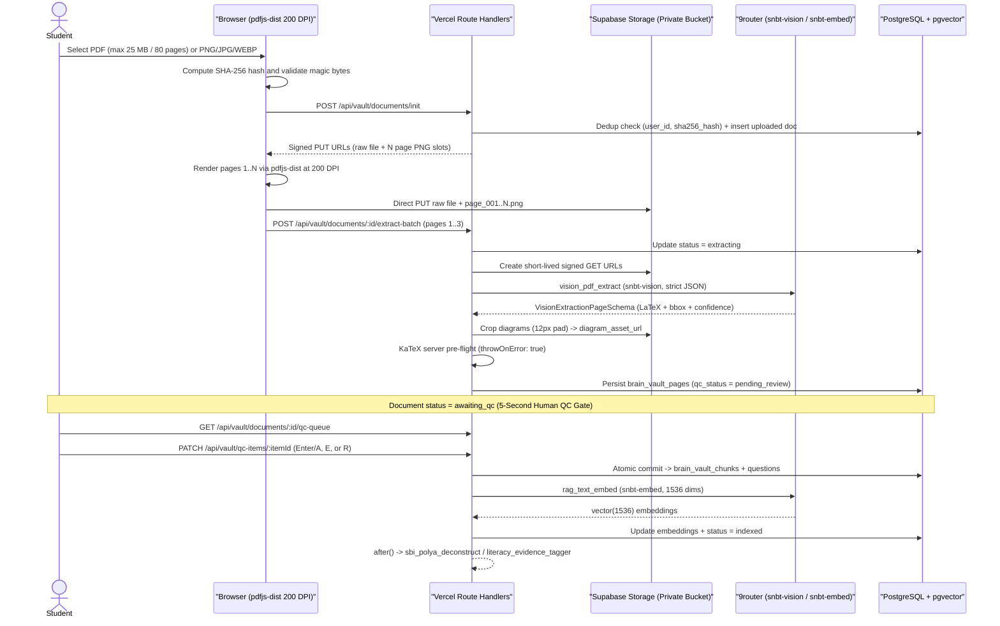
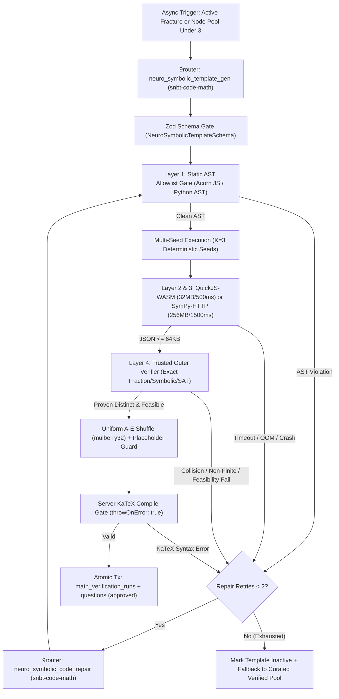

# 04: Concrete Data Flow Specifications

**Phase:** Phase A Deliverable 4 (`04-pipelines.md`)
**Covers:**
- **Part A:** Vision-First PDF/Screenshot Ingestion + 5-Second Human QC Gate -> Hybrid RAG ("My Brain Vault")
- **Part B:** Neuro-Symbolic Zero-Hallucination Question Generation & Verification Pipeline

---

## Part A: Vision-First PDF Ingestion, 5-Second Human QC Gate & Hybrid RAG

### A.1 Architectural Invariant: Why Vision-First + Browser Rasterization

1. **Why raw PDF text extractors (`pdf-parse`, `pdfplumber`) fail Indonesian *bank soal*:** Uploaded UTBK PDFs routinely encode fractions, integrals, roots, geometry labels, and scanned *bimbel* handouts as broken glyph streams, multi-column text runs, or flat images where text parsers drop exponents (`x^2` -> `x2`) or scramble numerator/denominator order.
2. **Why rasterization runs in the browser (`pdfjs-dist`):** Vercel Serverless lacks native `poppler-utils` (`pdftoppm`) binaries and enforces strict execution/payload limits. Rendering pages locally via `pdfjs-dist` onto an offscreen HTML5 `<canvas>` at **200 DPI (capped at `2048px` longest edge)** produces crisp lossless PNGs client-side, uploads them straight to Supabase Storage via short-lived signed PUT URLs, and sends only lightweight storage keys to Vercel Route Handlers.

### A.2 End-to-End Ingestion & QC Flow



### A.3 Stage-by-Stage Concrete Specification

#### Stage 1: Client Preflight & Deduplication (`POST /api/vault/documents/init`)
- **Validation:** Magic bytes verified (`%PDF-`, PNG, JPEG, WebP). Caps enforced: PDF `<= 25 MB` and `<= 80 pages`; single screenshot `<= 10 MB`.
- **SHA-256 Check:** Browser hashes the file with WebCrypto (`crypto.subtle.digest('SHA-256', buf)`). If `(user_id, sha256_hash)` already exists in `brain_vault_documents` with status `indexed` or `awaiting_qc`, return the existing `document_id` immediately without re-burning Vision tokens.
- **Response:** Returns `document_id` and presigned Supabase Storage PUT URLs for `vault/{user_id}/{document_id}/source.pdf` and `pages/page_{001..N}.png`.

#### Stage 2: Browser-Side Deterministic Rasterization
- Browser loads `pdfjs-dist` Web Worker, iterates pages `1..N`, scales each viewport so `max(width, height) = min(2048, round(viewport_72dpi * (200 / 72)))`, draws white paper background (`#FFFFFF`) before rendering (preventing transparent-background black text issues), exports `image/png`, and uploads directly to Supabase Storage.
- Status flips via `PATCH /api/vault/documents/:id/rasterized` (`status = 'rasterizing' -> 'extracting'`).

#### Stage 3: Chunked Vision Extraction (`POST /api/vault/documents/:id/extract-batch`)
- Client sends batches of **at most 3 pages** per HTTP call (staying safely under Vercel Hobby/Pro function timeouts and supporting clean page-level retry on refresh).
- Server invokes `9router` task `vision_pdf_extract` (`snbt-vision`) with `VisionExtractionPageSchema`:
  - Extracts `item_type` (`question`, `rumus_cepat`, `worked_solution`, `concept_note`), `stem_markdown`, `stem_latex`, `options`, `correct_answer_key`, `official_solution_markdown`, `method_label`, `validity_conditions` (mandatory whenever `item_type === 'rumus_cepat'`), normalized diagram bounding boxes `[x1, y1, x2, y2]` (`0..1000`), `extraction_confidence`, and `ocr_warnings`.

#### Stage 4: Deterministic Diagram Cropping & KaTeX Pre-Flight Gate
- For every `diagrams` entry with valid `[x1, y1, x2, y2]` (`x2 > x1` and `y2 > y1`):
  - Compute pixel rect from page PNG dimensions plus `12px` padding clamped to image bounds.
  - Crop via `sharp` into `vault/{user_id}/{document_id}/crops/p{page}_d{idx}.png` and upload to Supabase Storage.
- For every extracted LaTeX expression (`stem_latex`, option `latex`, solution inline `$...$` / `$$...$$`):
  - Execute `katex.renderToString(expr, { throwOnError: true, strict: "warn" })`.
  - Sets `brain_vault_pages.katex_valid = true/false`. On syntax errors, appends the exact KaTeX error location to `ocr_warnings` so the human QC gate highlights it immediately.

#### Stage 5: The 5-Second Human-in-the-Loop QC Gate
No extracted PDF note or question enters live Hybrid RAG search or drills until approved (`qc_status = 'approved'`):
- **Queue Endpoint:** `GET /api/vault/documents/:id/qc-queue` returns ordered items (`pending_review` first, low-confidence or `katex_valid = false` flagged prominently).
- **Split Review Card:** Left side renders the cropped page region PNG; right side renders live KaTeX + structured metadata (`subtest_guess`, `tier_guess`, `concept_tag`, `validity_conditions`).
- **Keyboard Velocity:**
  - `Enter` or `A`: Approve item (`qc_status = 'approved'`) and auto-advance to next item (`< 5 seconds` per item).
  - `E`: Focus inline LaTeX / Markdown / Answer editor with real-time KaTeX preview.
  - `R`: Reject item (`qc_status = 'rejected'`).
- **Gated Batch-Approve Rule:** Bulk approval (`POST /api/vault/documents/:id/batch-approve`) is **strictly permitted ONLY** for items satisfying all three predicates simultaneously: `extraction_confidence >= 0.92 AND katex_valid = TRUE AND cardinality(ocr_warnings) = 0`.
- **Update Endpoint:** `PATCH /api/vault/qc-items/:itemId` saves human edits, re-runs `katex.renderToString(..., { throwOnError: true })`, and commits atomically inside a PostgreSQL transaction.

#### Stage 6: Atomic Indexing & Asynchronous Pedagogical Enrichment
Upon QC approval (`qc_status = 'approved'`):
1. **Semantic Educational Chunking:** Inserts into `brain_vault_chunks` (and `questions` when `item_type = 'question'`). Chunks never split inside `$$...$$` math delimiters or `solution_steps` and are capped at `<= 1200` tokens. Personal notes and shortcuts set `is_user_priority = TRUE`.
2. **Dense + Sparse Indexing:** Calls `rag_text_embed` (`snbt-embed`, `vector(1536)`) to store `embedding`; PostgreSQL `GENERATED ALWAYS` column computes Indonesian `search_tsv` automatically alongside `pg_trgm` on `content_latex`.
3. **Async `after()` Enrichment:**
   - Quantitative items call `sbi_polya_deconstruct` (`snbt-reason`) to populate `sbi_deconstruction` and `solution_steps`.
   - Literacy items call `literacy_evidence_tagger` (`snbt-reason`) to index `passage_sentences` and `evidence_sentence_ids`.
   - Once zero `pending_review` pages remain, `brain_vault_documents.status` flips to `indexed`.

### A.4 Executable Hybrid RAG Query ("User Brain Vault First")

```sql
-- Hybrid RAG Retrieval: Dense Cosine (HNSW) + Sparse (Indonesian tsvector + LaTeX Trigram)
-- Weighted RRF (k = 60) with mandatory 1.35x priority multiplier for user Brain Vault notes.
-- Parameters:
--   $1 :: uuid          -- authenticated user_id
--   $2 :: vector(1536)  -- query embedding from rag_text_embed
--   $3 :: text          -- plain Indonesian/English query text
--   $4 :: text          -- raw LaTeX expression fragment (empty string if none)
--   $5 :: snbt_subtest  -- optional subtest filter (nullable)

WITH params AS (
    SELECT
        $1::uuid AS uid,
        $2::vector(1536) AS qvec,
        plainto_tsquery('indonesian', $3) AS tsq,
        NULLIF(trim($4), '') AS tex_q,
        $5::snbt_subtest AS subtest_filter
),
dense_candidates AS (
    SELECT
        c.id,
        (1.0 - (c.embedding <=> p.qvec)) AS cosine_similarity,
        ROW_NUMBER() OVER (ORDER BY c.embedding <=> p.qvec ASC) AS dense_rank
    FROM brain_vault_chunks c
    CROSS JOIN params p
    WHERE c.qc_status = 'approved'
      AND c.embedding IS NOT NULL
      AND c.user_id = p.uid
      AND (p.subtest_filter IS NULL OR c.subtest = p.subtest_filter)
    ORDER BY c.embedding <=> p.qvec ASC
    LIMIT 25
),
sparse_candidates AS (
    SELECT
        c.id,
        (
            COALESCE(ts_rank_cd(c.search_tsv, p.tsq), 0.0)
            + CASE
                WHEN p.tex_q IS NOT NULL AND c.content_latex IS NOT NULL
                THEN similarity(c.content_latex, p.tex_q) * 0.75
                ELSE 0.0
              END
        ) AS sparse_score,
        ROW_NUMBER() OVER (
            ORDER BY (
                COALESCE(ts_rank_cd(c.search_tsv, p.tsq), 0.0)
                + CASE
                    WHEN p.tex_q IS NOT NULL AND c.content_latex IS NOT NULL
                    THEN similarity(c.content_latex, p.tex_q) * 0.75
                    ELSE 0.0
                  END
            ) DESC
        ) AS sparse_rank
    FROM brain_vault_chunks c
    CROSS JOIN params p
    WHERE c.qc_status = 'approved'
      AND c.user_id = p.uid
      AND (p.subtest_filter IS NULL OR c.subtest = p.subtest_filter)
      AND (
          c.search_tsv @@ p.tsq
          OR (p.tex_q IS NOT NULL AND c.content_latex % p.tex_q)
      )
    LIMIT 25
),
fused AS (
    SELECT
        c.id,
        c.document_id,
        c.skill_node_id,
        c.chunk_type,
        c.method_label,
        c.validity_conditions,
        c.content_markdown,
        c.content_latex,
        c.diagram_asset_url,
        c.is_user_priority,
        COALESCE(d.cosine_similarity, 0.0) AS cosine_similarity,
        (
            (CASE WHEN d.dense_rank IS NOT NULL THEN 0.60 / (60.0 + d.dense_rank) ELSE 0.0 END)
            + (CASE WHEN s.sparse_rank IS NOT NULL THEN 0.40 / (60.0 + s.sparse_rank) ELSE 0.0 END)
        ) * (CASE WHEN c.is_user_priority THEN 1.35 ELSE 1.00 END) AS rrf_score
    FROM brain_vault_chunks c
    LEFT JOIN dense_candidates d ON d.id = c.id
    LEFT JOIN sparse_candidates s ON s.id = c.id
    WHERE d.id IS NOT NULL OR s.id IS NOT NULL
)
SELECT
    id,
    document_id,
    skill_node_id,
    chunk_type,
    method_label,
    validity_conditions,
    content_markdown,
    content_latex,
    diagram_asset_url,
    is_user_priority,
    cosine_similarity,
    rrf_score
FROM fused
WHERE rrf_score >= 0.012 OR cosine_similarity >= 0.720
ORDER BY rrf_score DESC, cosine_similarity DESC
LIMIT 6;
```

**Grounding & Safety Rules Applied at Application Layer:**
- **Citation Gate:** Only chunks clearing `rrf_score >= 0.012 OR cosine_similarity >= 0.720` trigger `SocraticTutorService` `L1_vault_nudge` (`grounded_in_user_vault = true`).
- **Shortcut Boundary Guardrail:** Whenever `chunk_type = 'rumus_cepat'` and `validity_conditions IS NOT NULL`, the tutor prompt MUST surface a concise 1-line applicability condition (e.g., *"Berlaku khusus jika koefisien kuadrat bernilai positif dan akar real."*), setting `socratic_hint_logs.boundary_warning_shown = true`.
- **Prompt-Injection Fencing:** Retrieved content is escaped and wrapped in `<untrusted_vault_excerpt source_id="...">...</untrusted_vault_excerpt>` with system instructions treating tags strictly as inert study notes.

---

## Part B: Neuro-Symbolic Zero-Hallucination Question Generation & Verification

### B.1 Core Zero-Hallucination Invariant

**Rule:** The LLM (`snbt-code-math`) NEVER computes final answers, NEVER picks numeric distractor options directly, and NEVER self-validates arithmetic. The LLM writes only:
1. A parameterized LaTeX/Markdown stem template (`stem_template_latex`).
2. Polya/SBI scaffolding step templates (`solution_step_templates`).
3. Pure deterministic generator code (`generator_code`) producing exact parameters, ground truth, and misconception-derived distractors inside an isolated sandbox.

PostgreSQL enforces this invariant physically via `CONSTRAINT chk_questions_neuro_symbolic_verified` (`verification_run_id IS NOT NULL` for every `neuro_symbolic_isomorphic` quantitative question).

### B.2 Verification Pipeline Flow



### B.3 End-to-End Concrete Worked Example (SNBT `PK` / `PM` Inverse Work-Rate)

Suppose a student failed an inverse work-rate question (*perbandingan berbalik nilai*) due to `formula_misapplication` (confusing direct proportion with inverse proportion). An `after()` hook triggers `neuro_symbolic_template_gen`.

#### Step 1: Parameterized Template & Pure Rational Generator (`quickjs_wasm` Default)
Notice zero floating-point drift (`Fraction`) and deterministic PRNG (`rng.int(min, max)`):

```javascript
// Executed inside ephemeral QuickJS-WASM sandbox (zero network, zero fs, 32MB, 500ms)
// Pre-injected frozen globals: Fraction, math, satSolve, rng(seed)
function generate(seed) {
  const r = rng(seed);
  const w1 = r.pick([6, 8, 9, 10, 12, 15]);
  const k = r.pick([2, 3, 4]);
  const d1 = k * r.pick([4, 5, 6, 8]);
  // Ensure clean fractional or integer target without floating-point guesswork
  const extraWorkers = r.pick([3, 4, 6, 8]);
  const w2 = w1 + extraWorkers;

  const totalWork = new Fraction(w1 * d1);
  const d2 = totalWork.div(w2); // exact rational Fraction

  // Misconception-derived distractors (never random guessing)
  const trapDirectProportion = new Fraction(d1 * w2, w1); // direct instead of inverse
  const trapAdditiveDrop = d1 - extraWorkers;             // linear subtraction error
  const trapRatioInvert = new Fraction(w1 * w2, d1);      // inverted numerator/denom
  const trapOffByOne = d2.add(2);                         // arithmetic slip

  const formatFrac = (f) =>
    f.d === 1 ? String(f.n) : `\\frac{${f.n}}{${f.d}}`;

  return {
    params: { w1: String(w1), d1: String(d1), w2: String(w2), extra: String(extraWorkers) },
    correct: {
      canonical: d2.toFraction(false),
      display_latex: `${formatFrac(d2)} \\text{ hari}`
    },
    distractors: [
      {
        canonical: trapDirectProportion.toFraction(false),
        display_latex: `${formatFrac(trapDirectProportion)} \\text{ hari}`,
        trap_type: "formula_misapplication"
      },
      {
        canonical: String(trapAdditiveDrop),
        display_latex: `${trapAdditiveDrop} \\text{ hari}`,
        trap_type: "translation_error"
      },
      {
        canonical: trapRatioInvert.toFraction(false),
        display_latex: `${formatFrac(trapRatioInvert)} \\text{ hari}`,
        trap_type: "arithmetic_slip"
      },
      {
        canonical: trapOffByOne.toFraction(false),
        display_latex: `${formatFrac(trapOffByOne)} \\text{ hari}`,
        trap_type: "arithmetic_slip"
      }
    ],
    feasibility_assertions: [
      w1 > 0 && d1 > 0 && w2 > w1,
      d2.valueOf() > 0 && d2.valueOf() < d1,
      trapAdditiveDrop > 0
    ]
  };
}
```

*(Note: When `MATH_SANDBOX_DRIVER=sympy_http` is enabled for advanced calculus or symbolic expressions, the identical template schema carries `sandbox_runtime: "python_sympy"` with `sympy.Rational` / `sympy.simplify` and passes through the exact same AST gate and outer verifier.)*

#### Step 2: Multi-Seed Robustness Check (`K = 3`)
For newly synthesized templates, the application executes `generate(seed)` across `3` deterministic seeds derived from SHA-256 (`seed_1`, `seed_2`, `seed_3`). All `3` seeds must succeed without timeouts, feasibility failures, or distractor collisions before the template is marked `is_active = true`.

#### Step 3: Independent Trusted Outer Verification Harness
The Next.js host (never trusting script assertions) parses `correct.canonical` and `distractors[0..3].canonical` using trusted host-side `Fraction` + `mathjs.simplify`:

1. **Exact Cardinality:** `distractors.length === 4`.
2. **Feasibility Proof:** Every entry in `feasibility_assertions` is strictly `=== true`.
3. **Finite & Well-Formed:** No `NaN`, `Infinity`, `undefined`, or empty display strings.
4. **Pairwise Mathematical Non-Equivalence:**
   - For every `i in [0..3]`: `simplify("(${correct.canonical}) - (${distractors[i].canonical})")` evaluates non-zero (exact `Fraction.compare` or symbolic nonzero residual).
   - For every `0 <= i < j < 4`: `simplify("(${distractors[i].canonical}) - (${distractors[j].canonical})")` evaluates non-zero (prevents duplicate options such as `1/2` and `0.5`).
5. **`PU` Deductive Syllogism Verification Path:** For Penalaran Umum logic items, the outer harness invokes `satSolve` (exact truth-table solver over boolean clauses) to confirm that the correct conclusion holds in all satisfying models while each distractor either falsifies at least one premise or commits an invalid converse/inverse fallacy.

#### Step 4: Deterministic Hydration, Uniform Shuffling & KaTeX Gate
- Template placeholders (`{{w1}}`, `{{d1}}`, `{{w2}}`, `{{extra}}`) are substituted into `stem_template_latex` and `solution_step_templates`.
- An assertion checks `!/\{\{[a-zA-Z0-9_]+\}\}/.test(hydratedStem)` so zero raw placeholders can reach a student.
- Options (`1 correct + 4 distractors`) are shuffled with `mulberry32(seed ^ 0x9e3779b9)` into keys `["A", "B", "C", "D", "E"]`, guaranteeing a uniform 20% distribution and eliminating LLM option-B/C position bias.
- Every option and hydrated stem compiles via `katex.renderToString(..., { throwOnError: true })`.

#### Step 5: Atomic Persistence & Bounded Self-Repair
- **On Pass:** Inside a single PostgreSQL transaction, insert the immutable `math_verification_runs` proof (`status = 'passed'`, `execution_time_ms`, `peak_memory_kb`, `computed_ground_truth_json`, `computed_distractors_json`, `feasibility_checks_json`) and the hydrated row in `questions` (`source_type = 'neuro_symbolic_isomorphic'`, `qc_status = 'approved'`, `verification_run_id = run.id`).
- **On Fail (AST / Timeout / Collision / Feasibility / KaTeX):** Persist the failure row in `math_verification_runs`, then invoke `neuro_symbolic_code_repair` (`snbt-code-math`) with the exact error reason (capped at **`2` repair attempts**). If attempt #2 still fails, mark `question_templates.is_active = false`, alert telemetry, and serve an already-verified isomorphic variant or curated seed question seamlessly.
